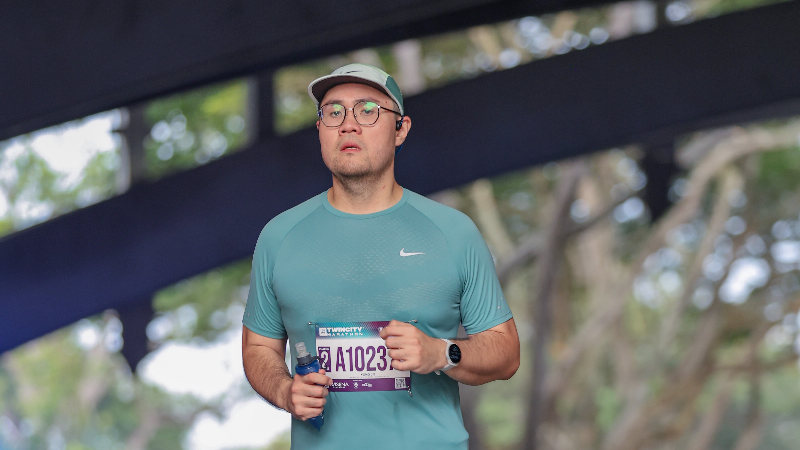
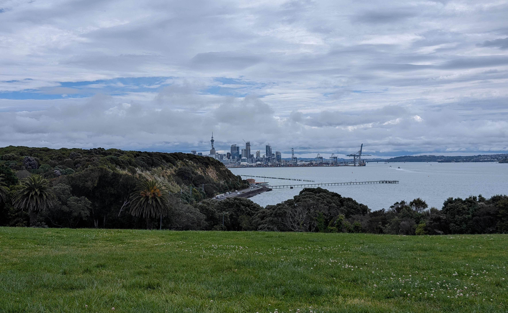
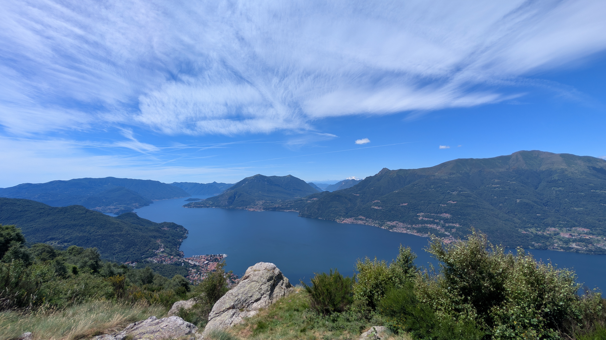

:::{#profile-section}
Currently a postgraduate student pursuing a Master of Commerce in Economics at the University of Auckland. 

Previously, I served as a Research Associate at the Tun Ismail Ali Center of Excellence (TIACOE) at the Asia School of Business, in collaboration with MIT Sloan.

### Research Interests (Current)
My interests lead me to the intersection of macroeconomics, monetary economics, and financial markets. 

I am actively researching:

- **Macroeconomics:** Investigating how central bank communication shapes market expectations within the Trilemma, and whether policy signaling can effectively manage capital flows and insulate economies from global financial spillovers.
- **Monetary Systems:** Examining the transition toward retail fast payment systems (FPS) and Central Bank Digital Currencies (CBDC), analyzing their impact on financial inclusion, cross-border network frictions, and regional dedollarization.
:::

---

### Personal Interests
In my downtime, you will find me usually training for my next long-distance marathon or enjoying a hike up the nearest mountain.

::: {.layout-ncol=3}
<figure>
  
  <figcaption style="text-align: left; font-size: 0.9em; margin-top: 8px; color: #555;">Twincity Marathon</figcaption>
</figure>

<figure>
  
  <figcaption style="text-align: left; font-size: 0.9em; margin-top: 8px; color: #555;">Bastion Point</figcaption>
</figure>

<figure>
  
  <figcaption style="text-align: left; font-size: 0.9em; margin-top: 8px; color: #555;">Lake Como</figcaption>
</figure>
:::