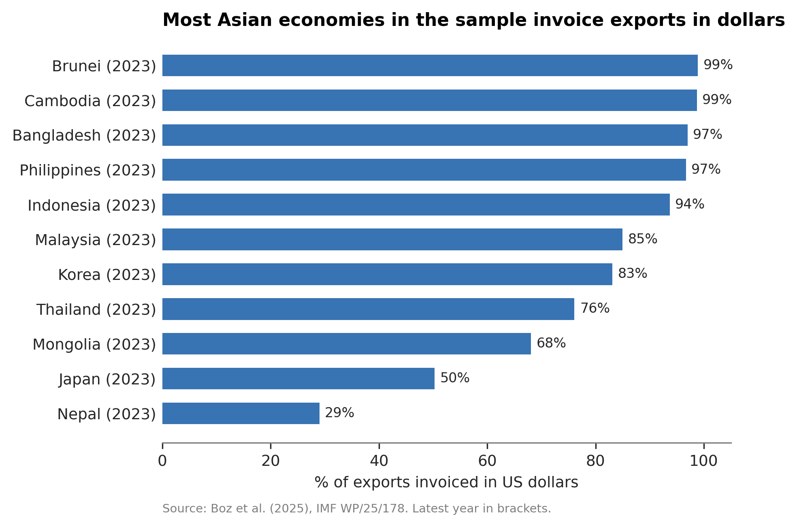

**Summary:** The US dollar still dominates Asian trade and finance. Yet a shift in its international role has begun at the base of the system. In this note, bottom-up describes the order of change, not who drives it. Payments and local currency settlement are moving first, largely led by central banks. Trade invoicing will follow slowly. Reserves and funding will move last. Over the next 10 to 15 years, this points to deeper local currency markets and a larger regional role for currencies in active settlement corridors. It does not point to the end of the dollar.

{fig-align="center" width="85%"}

[**Download the Full Research Note (PDF)**](dedollarisation-asia.pdf){.btn .btn-primary}
