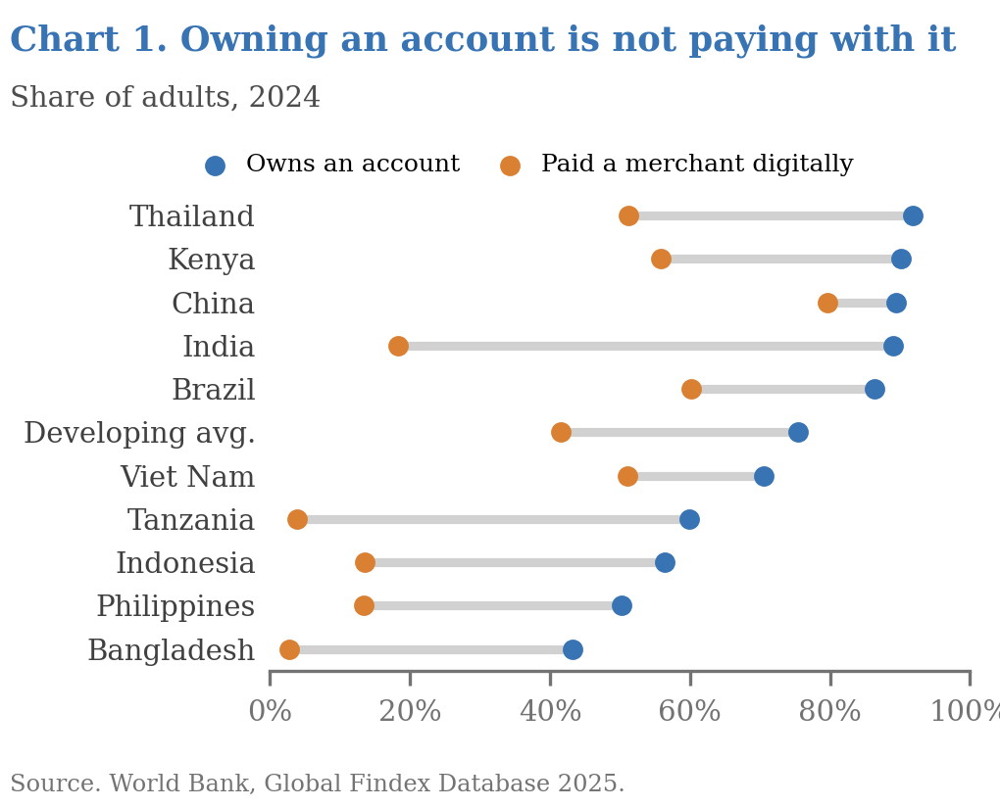

**Summary:** Frost, Rochet, Shin and Verdier (2025) predict that a public payment rail removes financial exclusion. In their model, inclusion means joining a payment network. The World Bank’s Global Findex lets us look further. It records who owns an account, who uses it to pay merchants, and how both differ by income. Two patterns stand out. Ownership runs well ahead of merchant use, most sharply in Tanzania and India. The income gap in ownership has narrowed in Kenya, but it reopened in Brazil after 2021. Both patterns fit the paper only in part. They also show where its assumptions are weakest and where further work could go.

{fig-align="center" width="85%"}

[**Download the Full Research Note (PDF)**](financial-inclusion.pdf){.btn .btn-primary}
